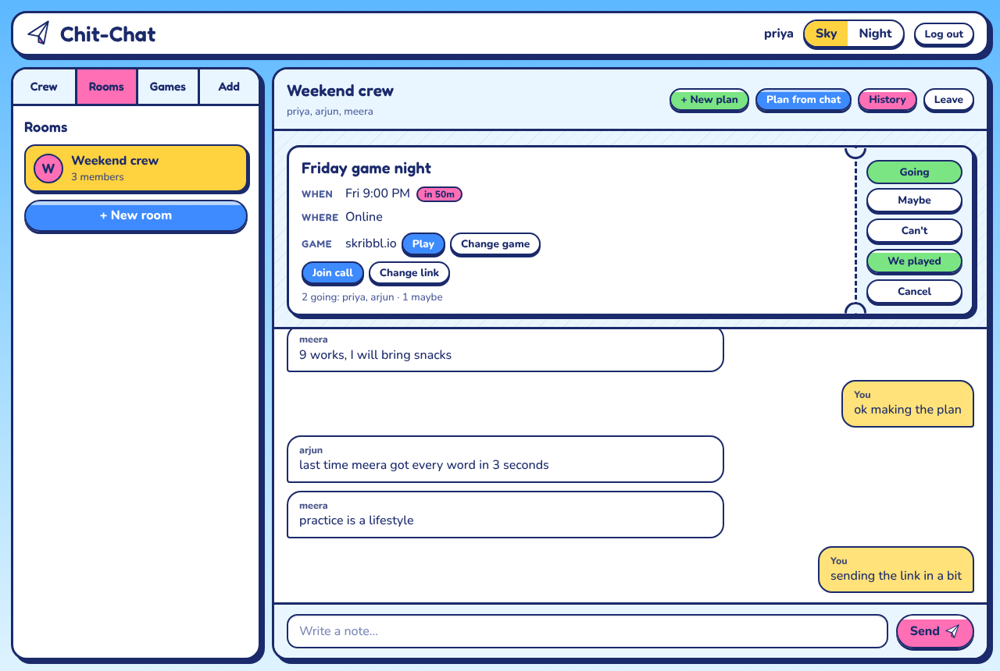
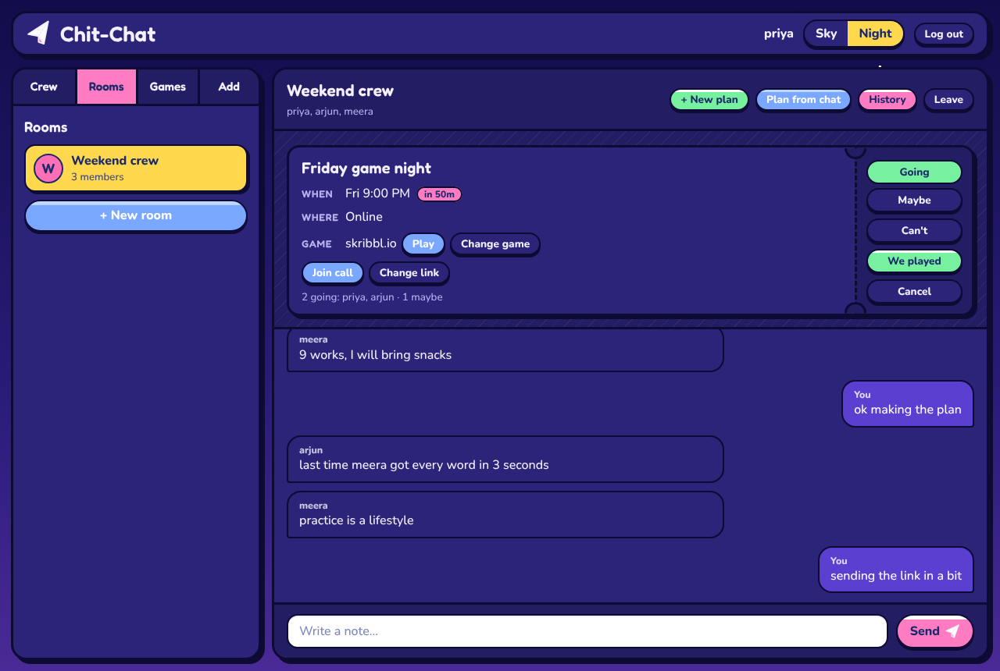
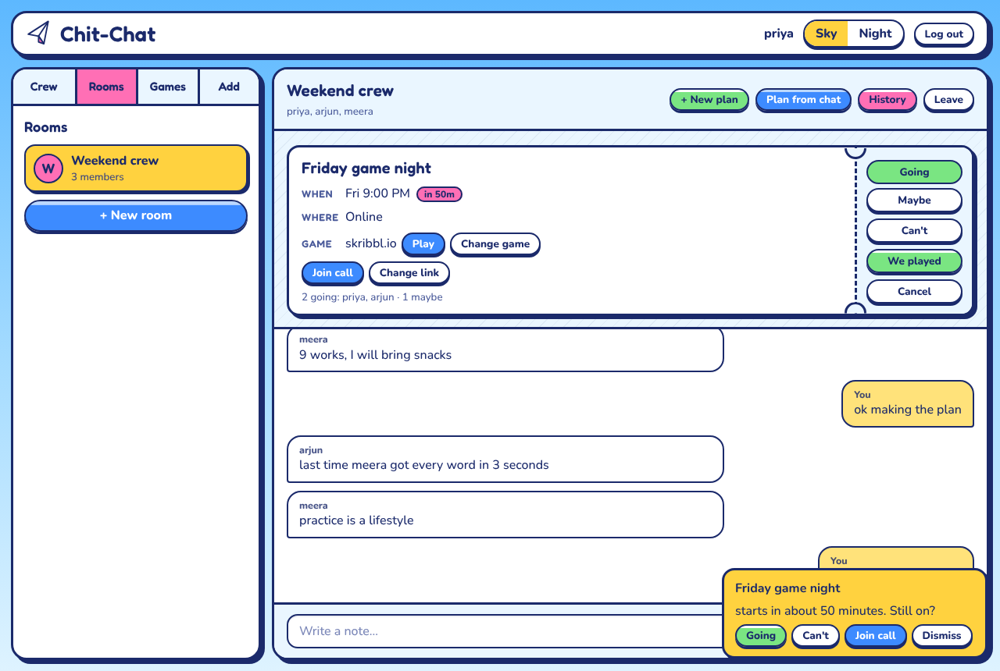
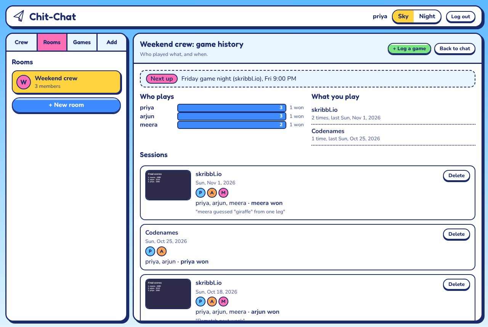
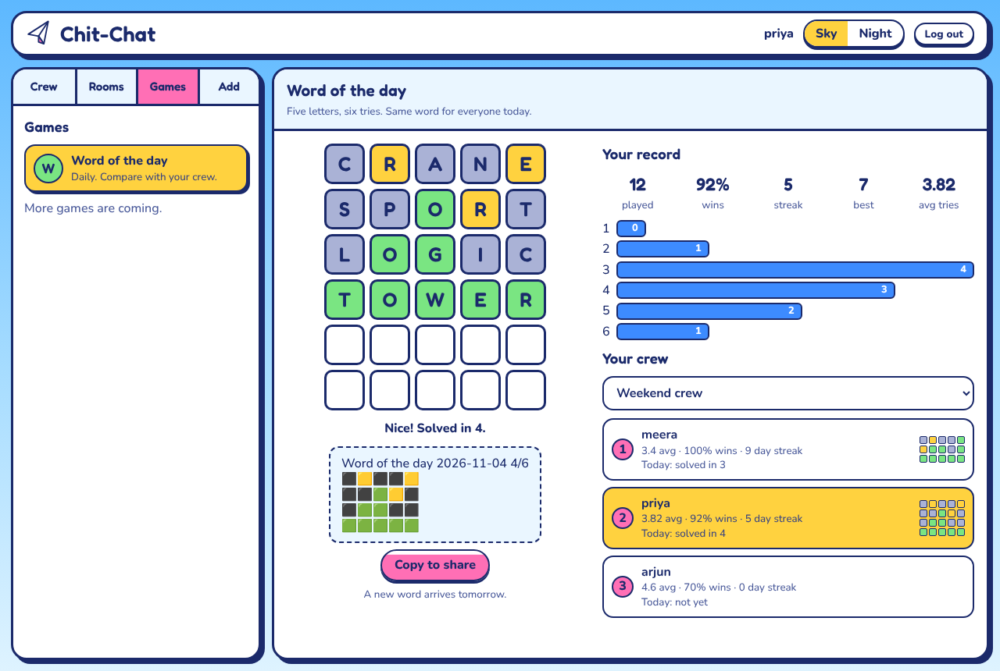
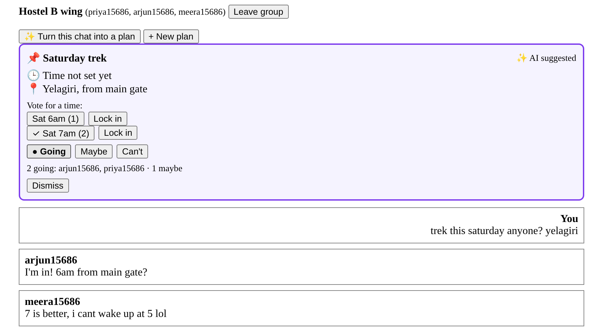

# ChitChat 

[](https://github.com/OjalSingh/Chit-Chat/actions/workflows/ci.yml)

> **A group-chat app for people who actually want to meet up: chat in rooms, turn the chatter into live plans with reminders and a call link, then play daily games and compare scores. Built on a hybrid REST + WebSocket backend.**

<p align="center">
  
  
</p>

## What you can do

- **Chat** one to one or in rooms, with live delivery and online presence.
- **Plan** together. A plan is a ticket with what, where and when, a time poll, Going / Maybe / Can't, an optional call link and reminders 1 hour and 5 minutes before. With an Anthropic key, the AI can draft the ticket from the chat.
- **Play together.** Pick a game on the plan (skribbl.io, Gartic Phone, Codenames, Among Us, Jackbox and more, or your own link). The ticket carries a Play button or a room code next to the call link. Chit-Chat doesn't host these games; it gets the group into them without the planning.
- **Keep the record.** After playing, press "We played" to log who was there, who won, a note and a screenshot of the scoreboard. Each room has a game history: who plays most, what you play, what's next.
- **Daily game.** Word of the day is built in, with streaks, averages and a room leaderboard that never spoils the answer.
- **Pick a look.** Two backgrounds (Sky and Night) in a paper-plane, Y2K style, with a layout that collapses to one column on phones.

<p align="center">
  
  
</p>
<p align="center">
  
</p>

> The sections below keep the original backend write-up (architecture, auth, presence, messaging) and then cover plans, games, the full API and the schema.

---

# Table of Contents

1. Overview
2. Tech Stack
3. System Architecture
4. Architectural Design Pattern
5. Core Features
6. Security
7. Design Decisions
8. System Event Flow
9. Project Structure
10. Running Locally
11. Environment Variables
12. API Documentation
13. Database Schema Deep Dive
14. Engineering Highlights
15. Future Extensions & Scaling Strategy
16. Games

Plan cards, group chats and tests are documented inside *Running Locally*; the new API endpoints are in *API Documentation*.

---

# Overview

ChitChat is a full-stack real-time messaging application built to explore production-inspired backend architecture rather than simply implementing a chat interface.

The project emphasizes:

- Secure authentication and authorization
- Event-driven communication using Socket.IO
- Hybrid HTTP + WebSocket synchronization
- Clean separation of REST and real-time responsibilities
- Modular Express architecture
- MongoDB data modeling
- Scalable system design principles

Unlike many beginner chat applications that rely entirely on WebSockets, ChitChat deliberately separates **persistent business operations** from **real-time UI synchronization**, closely mirroring the architecture used in modern production systems.

---
# Tech Stack

### Backend

- Node.js
- Express.js
- Socket.IO
- MongoDB
- Mongoose
- JWT Authentication
- Cookie-based Sessions
- Arcjet Middleware

### Frontend

- Preact (React-compatible) with React Router
- Vite
- Hooks and plain CSS (design tokens, two themes)
- Socket.IO client

---

# Architecture

```
                    +----------------+
                    | Preact (Vite)  |
                    +----------------+
                          │
          ┌───────────────┴───────────────┐
          │                               │
      HTTP REST                     WebSockets
  (Authoritative State)          (Live Events)
          │                               │
          └───────────────┬───────────────┘
                          │
                Express + Socket.IO Server
                          │
             Authentication Middleware
                          │
                MongoDB (Persistent Store)
```

---

# Architectural Design Pattern

## Hybrid REST + WebSocket Event Model

Rather than treating WebSockets as the source of truth, ChitChat follows a **hybrid communication model**.

### REST Responsibilities

REST endpoints own every persistent business operation.

Examples include:

- Login
- Registration
- User search
- Friend requests
- Accepting requests
- Rejecting requests
- Sending messages
- Loading conversations

Every mutation first succeeds inside MongoDB before any real-time event is emitted.

This guarantees:

- Atomic writes
- Database consistency
- Retry safety
- Easier debugging
- Predictable API behavior

---

### WebSocket Responsibilities

Socket.IO is responsible only for synchronizing connected clients.

Examples include:

- Incoming messages
- Friend request notifications
- Presence updates
- Friend list refreshes
- Live online indicators

The socket layer never replaces persistence—it simply mirrors successful backend state changes.

This significantly reduces unnecessary HTTP polling while maintaining data integrity.

---

# Core Features

## Authentication & Route Protection

- JWT-based authentication
- Cookie-backed session handling
- Protected REST endpoints
- Socket.IO handshake authentication
- Shared middleware between HTTP and WebSocket layers

---

## Live Presence Tracking

Every authenticated socket is registered inside a lightweight server-side connection registry.

```text
userSocketMap

UserID
    ↓
SocketID
```

Whenever a client connects or disconnects:

- Active socket registry updates
- Online user list is recalculated
- Presence events are broadcast to every connected client

The frontend instantly reflects:

- Online users
- Offline users
- Live green status indicators

without polling.

---

## Real-Time Friendship Workflow

Friendship follows a production-inspired event pipeline.

Operations:

- Search users
- Send request
- Receive request instantly
- Accept request
- Reject request
- Automatically refresh friend roster

Each action first commits through REST before broadcasting lightweight socket events.

---

## Real-Time Messaging

Messages are persisted before being emitted.

Flow:

1. Validate request
2. Store message
3. Check recipient connection
4. Emit socket event
5. Receiver updates conversation instantly

This guarantees that every displayed message already exists in persistent storage.

---

# Security

Current security layers include:

- JWT verification
- Protected middleware
- Socket authentication
- Cookie validation
- Arcjet request protection
- API rate limiting
- Route authorization
- Server-side validation

The backend never trusts client state.

Every protected operation derives identity directly from authenticated middleware.

---

# Design Decisions

## Why a Hybrid REST + WebSocket Architecture?

Persistent operations such as authentication, friend management, and messaging are handled through REST endpoints to ensure atomic database writes, predictable error handling, and reliable API semantics. Once a mutation has been successfully committed, Socket.IO broadcasts lightweight events to synchronize connected clients in real time.

This separation establishes REST as the authoritative source of truth while WebSockets remain responsible solely for UI synchronization.

## Why MongoDB?

MongoDB's document model naturally represents users, friendships, and conversations while allowing flexible schema evolution as new features are introduced.

ObjectId references are used to model relationships, with population performed only when necessary to reduce unnecessary data transfer.


## Why a Separate FriendRequest Collection?

Instead of embedding pending requests inside each User document, friend requests are stored independently.

This approach:

- Prevents unbounded growth of user documents.
- Enables efficient querying of pending requests.
- Supports clear request lifecycles (Pending → Accepted/Rejected).
- Makes future features such as request history and expiration easier to implement.


## Why Socket Authentication?

Both REST endpoints and Socket.IO connections share the same authentication model.

Every socket connection passes through authentication middleware before joining the application, ensuring only verified users can receive presence updates, notifications, and live messages.

## Why Arcjet?

Traditional Express middleware such as rate limiters primarily protect individual endpoints after requests have already reached the application. Arcjet provides an additional security layer by applying centralized protection policies before requests are processed, helping mitigate common abuse patterns with minimal application code.

Arcjet is used to:

- Apply request rate limiting to sensitive endpoints.
- Reduce automated abuse such as bot traffic and repeated authentication attempts.
- Keep security policies centralized rather than scattering validation logic across controllers.
- Allow the application to focus on business logic while infrastructure-level concerns are handled by dedicated middleware.

This separation improves maintainability, simplifies future security enhancements, and reflects a production-oriented approach to backend API design.


## Why Maintain a Server-side Socket Registry?

The application maintains an in-memory `userSocketMap` that associates authenticated user IDs with active Socket.IO connections.

This enables:

- Instant message delivery
- Friend request notifications
- Presence broadcasting
- Efficient targeted event emission

without requiring unnecessary database lookups for every event.

---

# System Event Flow

## Authentication & Live Presence
```text
User

│
│ Login / Signup
▼

POST /auth/login
or
POST /auth/signup

│
▼

Backend Authentication

• Credentials validated
• JWT/Cookie issued
• Session established

│
▼

Frontend opens
Socket.IO connection

│
▼

Socket Authentication Middleware

• Verify authenticated user
• Reject unauthorized sockets

│
▼

Store Connection

userSocketMap

User ID → Socket ID

│
▼

Broadcast

getOnlineUsers

│
▼

All Connected Clients

Online indicators update

(No refresh required)
```

## Real-Time Messaging
```text
User A

│
│ Click "Send"
▼

POST /messages/send/:id

│
▼

Backend Validation

• Authenticated user
• Receiver exists
• Message not empty

│
▼

MongoDB

Persist Message

│
▼

Successful Database Commit

│
▼

Lookup receiver socket

userSocketMap

│
▼

Socket.IO

Emit:

newMessage

│
▼

User B

Receive event

│
▼

Current conversation?

├── Yes
│     │
│     ▼
│  Append message instantly
│
└── No
      │
      ▼
   Ignore until
   conversation opened

(No refresh required)
```

## Friend Request Lifecycle

```text
User A

│
│ Click "Add Friend"
▼

POST /friends/request/:userId

│
▼

Backend Validation

• User exists
• Not self
• No duplicate request
• Authentication verified

│
▼

MongoDB

Create FriendRequest

│
▼

Successful Database Commit

│
▼

Lookup receiver socket

userSocketMap

│
▼

Socket.IO

Emit:

friendRequestReceived

│
▼

User B

Instant UI update

(No refresh required)
```

---

# Project Structure

```text
backend/
└──src
    ├── controllers/
    |       ├── friend.controller.js
    |       ├── auth.controller.js
    |       └── message.controller.js
    ├── middleware/
    |       ├── arcjet.auth.middleware.js
    |       ├── auth.middleware.js
    |       └── socket.auth.middleware.js
    ├── models/
    |       ├── FriendRequest.js
    |       ├── Message.js
    |       └── User.js
    ├── routes/
    |       ├── auth.route.js
    |       ├── friend.route.js
    |       └── messages.route.js
    ├── lib/
    │     ├── socket.js
    │     ├── env.js
    │     ├── arcjet.js
    │     ├── utils.js
    │     └── db.js
    └── server.js

frontend/
└──src
    ├── controllers/
    |       ├── ChatWindow.jsx
    |       ├── FriendRequest.jsx
    |       ├── MessageInput.jsx
    |       ├── Sidebar.jsx
    |       └──  SearchUser.jsx
    ├── pages/
    |       ├── Chat.jsx
    |       ├── Login.jsx
    |       └──  Signup.jsx
    ├── api/
    |       ├── auth.js
    |       ├── client.js
    |       ├── friends.js
    |       ├── messages.js
    |       ├── socket.js
    └── app.jsx
```

The project follows clear separation between:

- Models
- Controllers
- Middleware
- Routes
- Socket infrastructure

keeping responsibilities isolated and maintainable.

---

# Running Locally

### Prerequisites

- Node.js 20+
- MongoDB
- npm

### Clone

```bash
git clone <repo-url>
cd chit-chat
```

### Backend

```bash
cd backend
npm install
```

Create a `.env`

```env
PORT=3000
MONGO_URI=
JWT_SECRET=
CLIENT_URL=http://localhost:5173
ARCJET_KEY=
ANTHROPIC_API_KEY=   # optional, turns on AI Plan cards
# Optional: PLAN_DETECTION=off, PLAN_REMINDERS=off, PLAN_TIMEZONE, GAME_TIMEZONE (see the table below)
```

Run

```bash
npm run dev
```

---

### Frontend

```bash
cd frontend
npm install
npm run dev
```

Frontend

```
http://localhost:5173
```

Backend

```
http://localhost:3000
```

---

### AI Plan cards

Group chats are where plans start ("trek Saturday?") and where they fall apart in 200 messages of "what time again?". Chit-Chat watches the conversation and, when people are arranging something, posts a live **Plan card**: what, where and when, a time poll built from what people suggested, and Going / Maybe / Can't buttons. Every tap goes to the whole group in real time.



How it works:

- **Debounced detection.** Each group message resets a timer. Once a group has been quiet for `PLAN_DEBOUNCE_MS` (10s), the server reads the last `PLAN_CONTEXT_MESSAGES` (20) messages and makes one model call, so the cost is one call per burst of chat, not one per message. Members can also press "Turn this chat into a plan" to run it straight away.
- **Structured output.** Claude returns JSON that matches a fixed schema (`plan_detected`, `confidence`, `title`, `where`, `when_text`, `starts_at`, `time_options`), using structured outputs at low effort. Results under `PLAN_MIN_CONFIDENCE` are dropped. Open plans are passed in so the same plan never gets a second card.
- **Untrusted input.** Chat text goes in as quoted data, never as instructions, and the model can only fill schema fields. A refusal or a truncated reply is treated as "no plan".
- **Live and race-safe.** RSVPs and votes are atomic MongoDB updates (`$set` on a positional match, or `$addToSet`/`$pull` with `arrayFilters`), so members tapping at the same moment never overwrite each other. Every change emits `plan:new` or `plan:update` to the group's room.
- **Evaluated.** `npm run eval:plans` runs 10 labeled conversations against the live model: real plans, small talk, vague wishes, past events, solo plans and a prompt-injection attempt. It reports precision and recall, and fails below 0.9 / 0.8.

| Method | Route | |
|--------|-------|-|
| GET / POST | `/api/groups/:groupId/plans` | list open plans, or create one by hand |
| POST | `/api/groups/:groupId/plans/detect` | run the AI detector now |
| POST | `/api/plans/:planId/rsvp` | `{ status: "going" \| "maybe" \| "out" }` |
| POST | `/api/plans/:planId/vote` | `{ optionId }`, toggles your vote |
| PATCH | `/api/plans/:planId` | edit details, `pickOptionId` to lock in a time, `status: "cancelled"` |

Configuration (backend `.env`): `ANTHROPIC_API_KEY` turns detection on. Optional settings are `PLAN_MODEL` (default `claude-opus-5-5`), `PLAN_TIMEZONE` (default `Asia/Kolkata`, used to resolve "Saturday 7am"), `PLAN_DEBOUNCE_MS`, `PLAN_CONTEXT_MESSAGES`, `PLAN_MIN_CONFIDENCE`, and `PLAN_DETECTION=off` to turn it off. Without a key, members can still create plans by hand.

### Call links and reminders

A plan can carry an `https` call link (Meet, Zoom, Discord). The ticket shows a Join call button, and the new-plan form links to `meet.new` for starting one. Plans with a start time get a reminder in the group 1 hour and 5 minutes before they start (a plan created less than an hour out gets only the 5 minute one). A server ticker checks every 30 seconds, claims each reminder with an atomic update so it fires once, and emits `plan:reminder`; the client shows a toast with Going, Can't and Join call. Changing the start time re-arms the reminders. Set `PLAN_REMINDERS=off` to disable the ticker.

### Group chats

Friends can be invited to named groups of up to 100 members. Nobody is added without saying yes: an invite shows only the room's name, who asked and how many are in, and the room stays closed until the invitee accepts. The creator is the first admin, admins invite or remove people, anyone can leave, and the longest-standing member is promoted if the last admin leaves.

| Method | Route | Who |
|--------|-------|-----|
| POST | `/api/groups` | anyone (invites your friends; they join when they accept) |
| GET | `/api/groups/invites` | rooms you were invited to |
| POST | `/api/groups/:groupId/accept` / `decline` | the invited person only |
| GET | `/api/groups` | your groups, most active first |
| GET | `/api/groups/:groupId` | members |
| PATCH | `/api/groups/:groupId` | admins (rename) |
| GET / POST | `/api/groups/:groupId/messages` | members |
| POST | `/api/groups/:groupId/members` | admins (sends invites) |
| DELETE | `/api/groups/:groupId/members/:userId` | admins, or yourself to leave |

Realtime: each socket joins a `group:<id>` room for every group on connect, and is added to new groups' rooms immediately. Events are `newGroupMessage` (to everyone in the room except the sender), `groupInvite` (to the invited person), `groupUpdated` and `groupRemoved`.

### Tests

The backend has an integration suite (Vitest + Supertest) that drives the real Express routes and Socket.IO server against MongoDB.

```bash
cd backend
npm test               # spins up an in-memory MongoDB automatically
npm run test:coverage  # same, with a coverage report in backend/coverage
```

To run against your own MongoDB instead, set `MONGO_URI_TEST=mongodb://localhost:27017`.

What it covers: signup and login validation, JWT cookie auth (missing, forged and expired tokens), message privacy between users, the friend-request lifecycle, username search, the Arcjet middleware's allow and deny paths, and socket authentication with live `newMessage` delivery.

GitHub Actions runs the suite on Node 20 and 22 against a MongoDB 7 service container, and builds the frontend, on every push and pull request.

---
## Environment Variables

Backend `.env`. Only the first four are required.

| Variable | Required | Purpose |
|---|---|---|
| `MONGO_URI` | yes | MongoDB connection string |
| `JWT_SECRET` | yes | Signs login cookies |
| `CLIENT_URL` | yes | Frontend origin, for CORS and Socket.IO |
| `ARCJET_KEY` | yes | Arcjet security middleware (bot, rate limit, shield) |
| `PORT` | no | Server port, default 3000 |
| `COOKIE_SAMESITE` | no | `strict` (default), `lax` or `none`. Use `none` (HTTPS only) when the frontend and API are on different sites |
| `ANTHROPIC_API_KEY` | no | Turns on AI Plan cards. Without it, plans are made by hand |
| `PLAN_DETECTION` | no | `off` disables AI detection even with a key |
| `PLAN_MODEL` | no | Model for detection, default `claude-opus-5-5` |
| `PLAN_TIMEZONE` | no | Resolves "Saturday 7am", default `Asia/Kolkata` |
| `PLAN_DEBOUNCE_MS`, `PLAN_CONTEXT_MESSAGES`, `PLAN_MIN_CONFIDENCE` | no | Tune AI detection |
| `PLAN_REMINDERS` | no | `off` disables the reminder ticker |
| `GAME_TIMEZONE` | no | Where the daily game day flips, defaults to `PLAN_TIMEZONE` |
| `GAME_SALT` | no | Salt for picking the daily word, defaults to `JWT_SECRET` |
| `MONGO_URI_TEST` | tests | MongoDB for the test suite |

The frontend talks to `http://localhost:3000` by default. For a deploy, set `VITE_API_URL` (for example `https://api.example.com`) when building the frontend.

---
# API Documentation

## Authentication

| Method | Endpoint           | Description                                                     |
| ------ | ------------------ | --------------------------------------------------------------- |
| POST   | `/api/auth/signup` | Register a new user account.                                    |
| POST   | `/api/auth/login`  | Authenticate a user and establish a session.                    |
| POST   | `/api/auth/logout` | Terminate the current authenticated session.                    |
| GET    | `/api/auth/verify` | Verify the current authenticated user and return their profile. |


## Friends

| Method | Endpoint                               | Description                                    |
| ------ | -------------------------------------- | ---------------------------------------------- |
| GET    | `/api/friends/search?username=<query>` | Search for users by username.                  |
| GET    | `/api/friends/requests`                | Retrieve all pending incoming friend requests. |
| GET    | `/api/friends`                         | Retrieve the authenticated user's friend list. |
| POST   | `/api/friends/request/:userId`         | Send a friend request to another user.         |
| PATCH  | `/api/friends/accept/:requestId`       | Accept a pending friend request.               |
| PATCH  | `/api/friends/reject/:requestId`       | Reject a pending friend request.               |


# Messages

| Method | Endpoint                 | Description                                                                   |
| ------ | ------------------------ | ----------------------------------------------------------------------------- |
| GET    | `/api/messages/chats`    | Retrieve all users with whom the authenticated user has active conversations. |
| GET    | `/api/messages/:id`      | Retrieve the complete conversation with a specific user.                      |
| POST   | `/api/messages/send/:id` | Send a text or image message to a specific user.                              |


## Groups

| Method | Endpoint | Description |
| ------ | -------- | ----------- |
| POST | `/api/groups` | Create a group and invite friends. Body `{ name, memberIds }`. |
| GET | `/api/groups/invites` | Rooms you've been invited to. |
| POST | `/api/groups/:groupId/accept`, `/decline` | Answer an invite. |
| GET | `/api/groups` | Your groups. |
| GET | `/api/groups/:groupId` | One group, if you are a member. |
| PATCH | `/api/groups/:groupId` | Rename (admins). |
| GET / POST | `/api/groups/:groupId/messages` | Read or send group messages. |
| POST | `/api/groups/:groupId/members` | Invite friends (admins). |
| DELETE | `/api/groups/:groupId/members/:userId` | Remove a member, or leave. |

## Plans

| Method | Endpoint | Description |
| ------ | -------- | ----------- |
| GET | `/api/groups/:groupId/plans` | Open plans in a group. |
| POST | `/api/groups/:groupId/plans` | Create a plan: `{ title, where?, whenText?, startsAt?, meetLink?, timeOptions? }`. A start time turns on reminders. |
| POST | `/api/groups/:groupId/plans/detect` | Ask the AI to read the chat now (503 without a key). |
| POST | `/api/plans/:planId/rsvp` | `{ status: going / maybe / out }`. |
| POST | `/api/plans/:planId/vote` | Toggle a vote on a time option. |
| PATCH | `/api/plans/:planId` | Edit details, set `meetLink` (https only) or `game` (`{ name, url?, code? }`, `null` clears), lock in a time, or cancel. |

Socket events: `plan:new`, `plan:update`, `plan:reminder`.

## Game sessions

| Method | Endpoint | Description |
| ------ | -------- | ----------- |
| GET | `/api/games/catalog` | Link games a plan can point at. |
| POST | `/api/groups/:groupId/sessions` | Log a game: `{ gameName, playerIds, winnerId?, note?, screenshot?, planId? }`. Players and winner must be members. Passing `planId` marks that plan done. |
| GET | `/api/groups/:groupId/sessions` | Newest 50 sessions plus stats: games played and wins per member, and how often each game was played. |
| GET | `/api/sessions/:sessionId/screenshot` | The scoreboard image (members only). |
| DELETE | `/api/sessions/:sessionId` | Whoever logged it, or a group admin. |

Screenshots are resized in the browser to a JPEG under about 750 KB and stored with the session, but the list endpoint never returns the image; it's fetched from its own endpoint, which only serves PNG, JPEG or WebP and sets `nosniff`. Socket events: `session:new`, `session:removed`.

## Games

| Method | Endpoint | Description |
| ------ | -------- | ----------- |
| GET | `/api/games` | List the available games. |
| GET | `/api/games/wordle/today` | Your game for today. |
| POST | `/api/games/wordle/guess` | `{ guess }`. Scored on the server. |
| GET | `/api/games/wordle/stats` | Your record. |
| GET | `/api/games/wordle/leaderboard/:groupId` | Ranking and today's grids for a room. |

Socket event: `game:result`.

### All endpoints were tested using the Thunder Client extension for Visual Studio Code during development.
---

# Database Schema Deep Dive

## User
```text
User
├── username
├── email
├── password
└── friends[]
```
### Significance
- Authentication data remains centralized.
- Friends are stored as ObjectId references.
- Population is performed only when required, reducing unnecessary document size.

## FriendRequest
```text
FriendRequest
├── sender
├── receiver
├── status
└── createdAt
```


### Significance

Instead of embedding pending requests inside the User document, friend requests are modeled independently because:
- avoids unbounded array growth
- supports querying pending requests efficiently
- enables audit/history if desired
- clean lifecycle (pending → accepted/rejected)

## Message
```text
Message
├── senderId
├── receiverId
├── text
├── image
└── createdAt
```

### Significance

Messages remain immutable and append-only.
Conversation history is reconstructed using
senderId == A && receiverId == B
OR
senderId == B && receiverId == A
This keeps writes extremely simple.

---

# Engineering Highlights

Rather than showcasing only CRUD operations, ChitChat demonstrates practical backend engineering concepts including:

- Hybrid REST + WebSocket architecture
- JWT authentication shared across HTTP and Socket.IO
- Event-driven synchronization
- Real-time presence systems
- Connection lifecycle management
- Secure middleware pipelines
- MongoDB relationship modeling
- Modular Express architecture
- Production-oriented scalability planning
- Clean separation between persistence and real-time communication
---

# Future Extensions

Next up:

- **A pluggable games system.** More daily games, plus live games played together in a room (drawing, social deduction), with shared scores and records.
- **Deploy.** Frontend on a static host, API on a Node host, MongoDB Atlas. The frontend's API URL is already `VITE_API_URL`; if they sit on different sites, set `COOKIE_SAMESITE=none` on the API.
- A public RSVP link and a shareable ticket image for plans.
- Sounds, haptics and stamp animations.

Later, for scale and polish:

- Redis Pub/Sub for multi-server Socket.IO synchronization, and a load test
- JWT refresh token rotation
- Read receipts, typing indicators and message pagination
- Push notifications
- Media uploads via Cloudinary

---

## Games

The Games tab holds small daily games with records you can compare in a room. The first is **Word of the day**, a five-letter, six-try word game. Everyone gets the same word on the same day (the day flips at midnight in `GAME_TIMEZONE`, default `Asia/Kolkata`), so scores are comparable across rooms.

- **The server scores every guess.** The word is picked from a curated list by a salted hash of the date (`GAME_SALT`, falling back to `JWT_SECRET`), and the client never receives it unless the game is lost. Guesses must be real words (about 12.5k, from the MIT-licensed `word-list` package). Updates are conditional, so double clicks or two tabs can't add a seventh guess or repeat a word.
- **Records.** Played, win rate, average tries, current and best streak, and a guess distribution, per player (`GET /api/games/wordle/stats`).
- **Compare.** `GET /api/games/wordle/leaderboard/:groupId` ranks a room by average tries. Each person's coloured grid for today shows only after you've finished today's word yourself, and only the colours are shared, never the words, so looking can't spoil it. Finishing emits `game:result` to the player's rooms so boards update live.
- **Share.** After finishing you can copy the usual coloured-squares summary.

Results are stored once per player per game per day (`GameResult`, unique on user, game and day), so adding another daily game means a new rules module and routes, not a new store.
